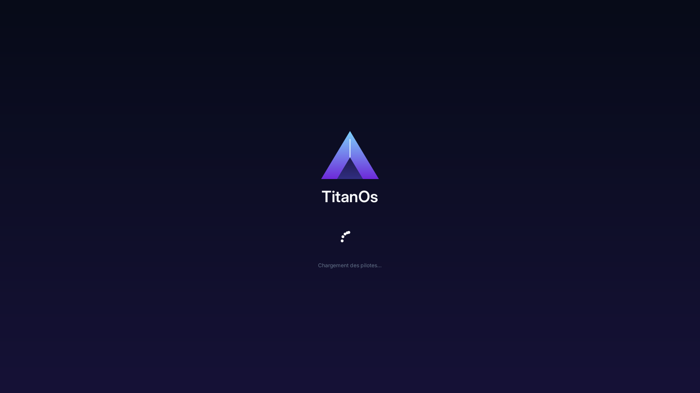
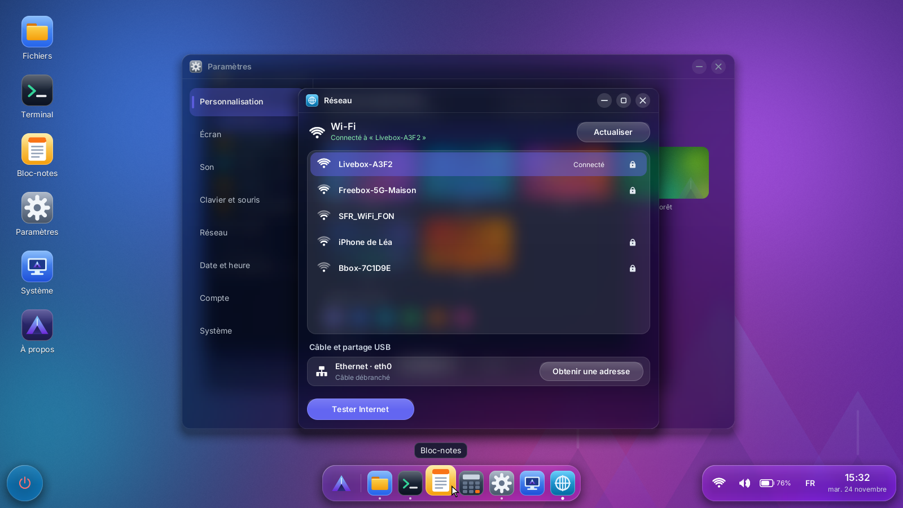
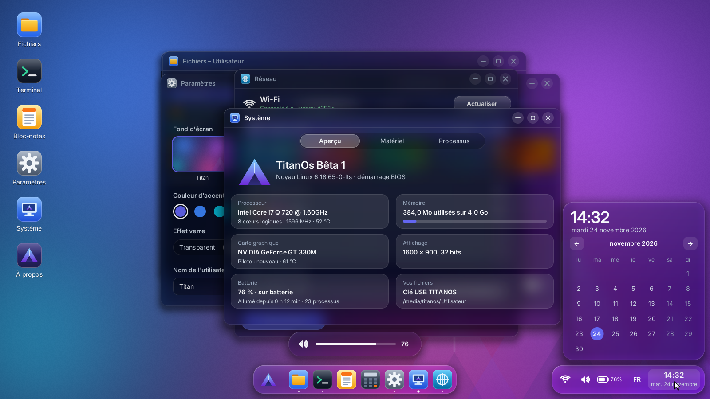

<div align="center">

# TitanOs

**Un système d'exploitation léger, sur base Linux, avec un bureau *liquid glass* écrit en C.**
Pensé pour le Sony VAIO série F, il démarre sur n'importe quel PC 64 bits (BIOS ou UEFI).

[**Télécharger la dernière version**](../../releases/latest) · [Historique des versions](CHANGELOG.md) · [Contribuer](CONTRIBUTING.md) · Licence GPL-3.0


</div>

---

## En bref

Seul le **noyau Linux** vient d'ailleurs : le paquet `linux-lts` d'Alpine Linux, pris tel quel. Tout le reste a été écrit pour TitanOs :
- les chargeurs de démarrage BIOS et UEFI ;
- `/init`, le chargement des pilotes ;
- le bureau, avec ses animations, ses sons et ses applications.

Le bureau est un seul programme en C, sans bibliothèque (ni libc, ni X11, ni Wayland) : il parle directement au noyau.

Quelques programmes d'Alpine sont embarqués pour ce qui ne se réinvente pas :
- BusyBox, pour les commandes du Terminal ;
- `wpa_supplicant`, pour le Wi-Fi ;
- `curl`, pour les mises à jour en HTTPS ;
- `apk`, pour installer des applications ;
- `mke2fs`.

## Points forts

| | |
|---|---|
| **Démarrage sans coupure** | Le logo et les *crêtes* animées s'affichent dès l'allumage. Linux reprend la même image, puis l'écran passe en fondu sur l'écran de verrouillage. |
| **Liquid glass** | Chaque panneau floute et réfracte ce qui est derrière lui, avec un liseré lumineux et un reflet. Le verre n'est recalculé que là où c'est utile. |
| **Fluide à 60 Hz** | Le bureau dessine dans une image en mémoire vidéo pendant que l'autre est affichée, et la carte graphique bascule au rafraîchissement de l'écran : pas de déchirure. |
| **Animations** | Les fenêtres s'ouvrent avec un léger zoom, se réduisent vers leur icône du dock et en reviennent. L'agrandissement est animé ; les menus et les notifications apparaissent en fondu. |
| **Mises à jour automatiques** | Une fois en ligne, TitanOs cherche une version plus récente ici, la télécharge en HTTPS, vérifie ses sommes SHA-256 et l'installe. Il suffit ensuite de redémarrer. |
| **Installation** | Depuis la clé, TitanOs se copie sur le disque interne ou sur une autre clé USB, avec vos fichiers. |
| **Intégration au portable** | Batterie, touches Fn (luminosité, volume), couvercle, bouton d'alimentation, mise en veille, températures, interrupteur Wi-Fi du VAIO. |
| **Navigateur web** | Chromium, la base libre de Google Chrome, s'installe tout seul dès la première connexion à Internet et s'ouvre dans une fenêtre TitanOs. Les téléchargements vont dans *Téléchargements*, le son passe par le haut-parleur. |
| **Logithèque** | LibreOffice, VS Code, Discord, GIMP, Python et Node.js s'installent en un clic. Chaque application graphique a sa propre fenêtre et rejoint le menu Démarrer avec son icône. |
| **Applications Linux** | `apk add htop` dans le Terminal installe un programme d'Alpine. Il reste installé dans l'espace des applications créé au premier démarrage. |
| **Pointeur** | Flèche noire bordée de blanc avec une ombre douce, affichée par la carte graphique : elle suit la souris sans attendre l'image suivante. Elle change de forme sur le texte, les coins de redimensionnement, les liens des pages web. |

<table>
<tr>
<td></td>
<td></td>
</tr>
<tr>
<td></td>
<td></td>
</tr>
<tr>
<td></td>
<td></td>
</tr>
<tr>
<td></td>
<td></td>
</tr>
</table>

## Installer

1. Téléchargez `titanos-betaN.img.zip` dans la [dernière version](../../releases/latest), puis décompressez-le.
2. Écrivez `titanos.img` sur une clé USB avec **Rufus, en mode DD**. Cela efface la clé : prenez-en une d'au moins 2 Go.
3. Démarrez sur la clé :
   - **Sony VAIO (BIOS)** : touche F2, onglet *Boot*, activez *External Device Boot* et mettez la clé en premier ;
   - **PC récent (UEFI)** : désactivez *Secure Boot*.
4. Pour l'installer sur le disque, utilisez l'application **Mises à jour**, puis « Installer sur ce disque… ». **Le disque choisi est entièrement effacé.**

Il faut 512 Mo de mémoire au minimum. Une fois TitanOs installé, les nouvelles versions arrivent toutes seules.

**Mettre à jour sans Internet** : démarrez sur une clé TitanOs plus récente, puis ouvrez Mises à jour et choisissez « Mettre à jour le disque » (vos fichiers sont gardés). Autre solution : copiez `titanos-maj.tar.gz` (dans chaque version publiée) sur une clé USB, branchez-la, puis cliquez sur « Installer ce paquet ».

## Applications

| Application | Rôle |
|---|---|
| **Chromium** | Navigateur web complet (onglets, favoris, mots de passe, téléchargements, vidéos avec le son), avec la disposition de clavier de TitanOs. |
| **Logithèque** | Installe et désinstalle LibreOffice, VS Code, Discord (Flathub), GIMP, Python 3 et Node.js. Les installations se font une à la fois, avec une barre de progression. |
| **Fichiers** | Dossiers et fichiers : créer, renommer (F2), dupliquer, supprimer avec confirmation. Chaque fichier s'ouvre avec la bonne application : textes dans le Bloc-notes, images dans la visionneuse, PDF, vidéos, musique et pages web dans Chromium. Les archives (zip, tar.gz, tar.xz…) s'extraient d'un double-clic. Les clés USB branchées apparaissent, avec un bouton *Éjecter*. |
| **Terminal** | Vrai terminal (VT100/xterm, 256 couleurs, historique). `aide` liste les commandes. |
| **Bloc-notes** | Édition UTF-8, sélection, copier/coller, Ctrl+S / Ctrl+O. Avertit avant de fermer un texte non enregistré. |
| **Image** | Visionneuse JPEG (séquentiel et progressif, orientation EXIF), PNG, GIF, BMP et PPM, ajustée à la fenêtre ; ← → pour l'image suivante. |
| **Calculatrice** | À la souris ou au clavier. |
| **Paramètres** | Personnalisation, écran, son, clavier et souris, réseau, date et heure, compte (mot de passe de session), système. |
| **Système** | Machine, températures, batterie, matériel PCI/USB avec son pilote, processus. |
| **Réseau** | Wi-Fi (réseaux, mot de passe affichable, réseaux enregistrés), câble, partage USB d'un téléphone. Le test de connexion vérifie chaque étape (adresse, box, Internet, DNS) et dit laquelle bloque. |
| **Mises à jour** | Version installée, recherche sur GitHub, installation sur un disque ou une clé USB. |
| **Snake**, **À propos** | |

**Raccourcis**

| Raccourci | Action |
|---|---|
| Touche Windows | Menu et recherche |
| Alt+Tab | Passer d'une fenêtre à l'autre |
| Alt+F4 | Fermer la fenêtre |
| Ctrl+Alt+T | Ouvrir le Terminal |
| Windows+L | Verrouiller la session |
| Impr. écran | Capture d'écran, enregistrée dans *Images* |

Le bouton rond en bas à gauche propose : mettre en veille, redémarrer ou éteindre.

**Bureau** : les icônes se déplacent à la souris. Elles se rangent dans une grille qui couvre tout l'écran, et gardent leur place. Pour ajouter un raccourci, faites un clic droit sur le bureau, sur une application du menu Démarrer, ou sur un fichier ou un dossier dans Fichiers. Pour le retirer : clic droit sur l'icône → « Retirer du bureau ».

## Matériel

TitanOs est réglé pour le **Sony VAIO série F (VPCF11)**.

| Composant | Prise en charge |
|---|---|
| Écran | Carte NVIDIA GeForce GT 330M (puce GT216) avec le pilote libre `nouveau` : 1920×1080 à 60 Hz, double tampon. Chaque image est envoyée à la carte au rafraîchissement de l'écran, puis la suivante est préparée aussitôt. Les mélanges sont calculés 4 pixels à la fois (SSE2), et la copie vers la mémoire vidéo contourne le cache. Au démarrage, le chargeur prend la résolution de l'écran, même si la carte ne la propose qu'en 16 ou 24 bits (image tramée). Sinon, il utilise des images dessinées pour le mode 1280×1024 du BIOS, aux bonnes proportions. Le pointeur est affiché par la carte (plan « curseur »). |
| Wi-Fi | Intel Centrino Advanced-N 6200 (`iwlwifi`, micrologiciel officiel d'Intel, sans coexistence Bluetooth ni économie d'énergie) ou Atheros AR9287 (`ath9k`). L'interrupteur WIRELESS est détecté et expliqué. |
| Câble | Marvell Yukon (`sky2`) : le branchement est surveillé, l'adresse est demandée tout de suite. Câble, partage USB d'un téléphone et Wi-Fi ont chacun leur priorité : Internet passe par le meilleur lien branché. |
| Son | HD Audio (Realtek ALC275), volume réglable aux touches Fn. Les applications (Chromium...) passent par ALSA, réglée sur cette sortie avec un mélangeur logiciel. |

Sur les autres PC, les pilotes Intel (`i915`), QEMU et VirtIO sont inclus. Sans pilote adapté, l'écran reste à la résolution donnée par le BIOS.

## Si quelque chose ne va pas

- **Journal** : TitanOs écrit `journal-titanos.txt` à la racine de la clé, toutes les 5 secondes pendant les 4 premières minutes, puis toutes les 5 minutes. Il y note les messages du noyau, les pilotes, le Wi-Fi, et où chaque processus attend.
- **Mode de secours** : si le bureau plante plusieurs fois de suite, TitanOs affiche la cause à l'écran et copie `rapport-titanos.txt` sur la clé.
- **Ligne de diagnostic** : en bas de l'écran de verrouillage, elle apparaît si la clé, le clavier ou le pointeur manquent.

Branchez la clé sur un autre ordinateur pour lire ces fichiers.

## Limites actuelles

- **Chromium**, mais pas Google Chrome : Google ne publie pas Chrome pour ce type de système (Linux avec musl). Chromium tourne dans un serveur X en mémoire (Xvfb), dessiné par le processeur : la navigation est fluide, mais les vidéos lourdes le sont moins. Il prend 900 Mo dans l'espace des applications.
- Les autres applications graphiques Linux ne sont pas encore intégrées : le pont X11 de Chromium pourra être étendu à d'autres programmes.
- Le dessin se fait au processeur : la carte graphique sert à l'affichage et à la synchronisation, pas à la 3D.
- Les mises à jour sont vérifiées par HTTPS et SHA-256, pas encore par une signature.

## Compiler

Prérequis : [LLVM](https://llvm.org) (`clang`, `ld.lld`, `lld-link`) et Python 3.14 ou plus récent (le build utilise `compression.zstd`).

```powershell
winget install LLVM.LLVM
```

```powershell
python build.py
```

Au premier lancement, le build télécharge environ 200 Mo et les garde dans `build/cache/` :
- depuis le miroir officiel d'Alpine : noyau, BusyBox, paquets et police Inter, tous vérifiés par leurs sommes de contrôle ;
- depuis le miroir officiel de linux-firmware : le micrologiciel Wi-Fi Intel, vérifié par son SHA-256.

| Résultat | Rôle |
|---|---|
| `build/titanos.img` | Image de 256 Mo pour clé USB (BIOS et UEFI) |
| `build/titanos.vhd` | La même image, en disque virtuel |
| `build/titanos-maj.tar.gz` et `build/VERSION` | Paquet de mise à jour, à publier avec chaque version |

```powershell
python build.py preview
```

Cette commande compile le bureau pour Windows et enregistre des captures dans `build/preview/`.

```powershell
python tools/testboot.py build/titanos.img build/preview/chargeur.png
```

Ce test exécute le MBR et le chargeur BIOS dans un émulateur de processeur, jusqu'à l'entrée du noyau Linux. Il demande `pip install unicorn`. `TESTBOOT_VAIO=2` et `TESTBOOT_NOEDID=1` imitent le BIOS du VAIO.

## Comment c'est construit

```
                 ┌─ BIOS ─► MBR (boot/mbr.S) ─► stage2 (boot/stage2.S) ─┐
PC allumé ──────►│                                                       ├─► noyau Linux ─► /init (TitanOs)
                 └─ UEFI ─► BOOTX64.EFI (boot/efiboot.c) ────────────────┘
```

- **stage2** choisit le mode graphique d'après l'écran (EDID) et dessine l'écran de démarrage depuis `TITANOS/BOOT.IMG`. Il lit ensuite le noyau et le système en mode « unreal », remplit la carte mémoire et entre dans Linux par son protocole 32 bits. Il transmet aussi la signature du disque qui a démarré.
- **efiboot** dessine le même écran, puis passe le système au noyau par le protocole LoadFile2.
- **`/init`** (PID 1) monte `/proc`, `/sys` et `/dev`, active la mémoire compressée (zram) et charge les pilotes. Il relance le bureau s'il s'arrête, et ouvre le mode de secours s'il plante en boucle.
- **La session** anime l'écran de démarrage pendant qu'un processus voisin charge les pilotes, monte la clé et prépare l'espace des applications. Un autre processus, le **veilleur**, interroge le Wi-Fi et la batterie : le bureau n'attend jamais le matériel.
- **Mises à jour** : les fichiers du système ont une taille fixe sur le disque. Les nouvelles versions les réécrivent sur place, puis réécrivent le chargeur.

## Organisation du code

```
build.py              compile tout ; « preview » pour les captures
boot/                 MBR, chargeur BIOS (stage2.S), chargeur UEFI (efiboot.c)
src/core/             le bureau, indépendant du système
  gfx.c glass.c icons.c           dessin lissé, verre, logo et icônes
  png.c jpeg.c                     images PNG, BMP, JPEG, GIF, PPM
  wm.c ui.c sound.c                fenêtres, dock, animations, widgets, sons
  apps.c term.c files.c notes.c prefs.c sysapp.c netapp.c updapp.c imgview.c browser.c store.c   applications
src/linux/            ce qui parle au noyau (appels système directs, sans libc)
  main.c                           /init, démarrage, clé, zram, espace des applications
  modules.c display.c input.c      pilotes, écran DRM/KMS (double tampon), clavier, souris, pavé tactile
  audio.c wifi.c plat.c            son ALSA, Wi-Fi (wpa_supplicant), fichiers, système, batterie, horloge
  update.c volumes.c xbridge.c     mises à jour et installation, clés USB, applications X11 (un serveur X par application)
src/sim/sim.c         version Windows du bureau, pour l'aperçu
rootfs/etc/           profil du shell, script DHCP, dépôts apk
tools/                téléchargement Alpine, polices, initramfs, image disque, écran de démarrage, tests
```

## Personnaliser

| Pour… | Modifier |
|---|---|
| ajouter une application | une fonction `app_xxx_open()` (voir `src/core/apps.c`), son icône dans `icons.c`, son nom dans `apps.c` et `desk.h` |
| changer l'effet verre | `style_for()` dans `src/core/wm.c`, et `src/core/glass.c` |
| fonds d'écran, couleurs, fuseaux | `src/core/settings.c` |
| les sons | `src/core/sound.c` (chaque son est une petite partition de notes) |
| ajouter un pilote ou un programme d'Alpine | `MODULES` et `PACKAGES` dans `tools/buildos.py` |
| les commandes du Terminal | `rootfs/etc/profile` |

## Licence

TitanOs est © 2026 **Titangp1**. Il est distribué sous la licence libre **GNU GPL version 3 ou ultérieure** : voir [LICENSE](LICENSE) et [NOTICE](NOTICE).

- Le projet et son code restent la propriété de leur auteur, et chaque copie doit le créditer.
- Tout le monde peut lire le code, l'utiliser et proposer des améliorations ([CONTRIBUTING.md](CONTRIBUTING.md)).
- Une version modifiée doit rester libre, sous la même licence, avec son code source. Personne ne peut en faire un logiciel fermé.
- Le nom TitanOs et son logo désignent la version officielle.

## Licences des composants embarqués

| Composant | Licence |
|---|---|
| Noyau Linux, BusyBox | GPL |
| `wpa_supplicant` | BSD |
| `curl` | Licence curl (MIT) |
| Police Inter | SIL OFL 1.1 |
| Micrologiciel Intel | Licence de redistribution d'Intel (linux-firmware) |
