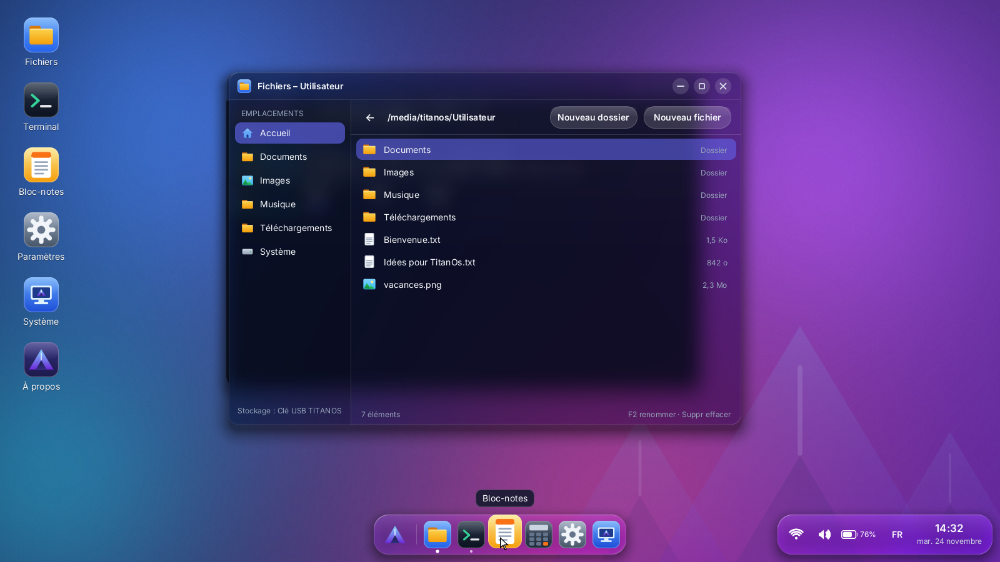
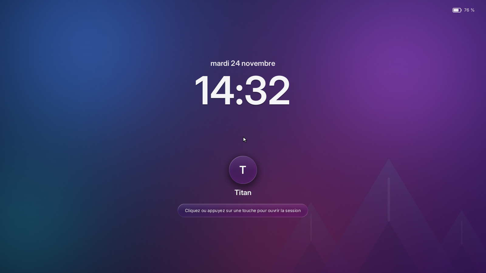
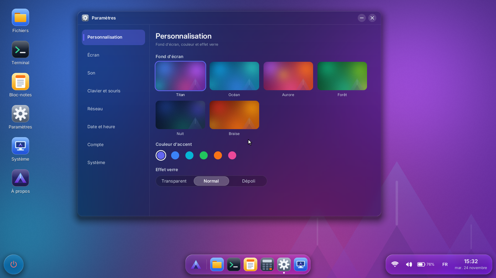
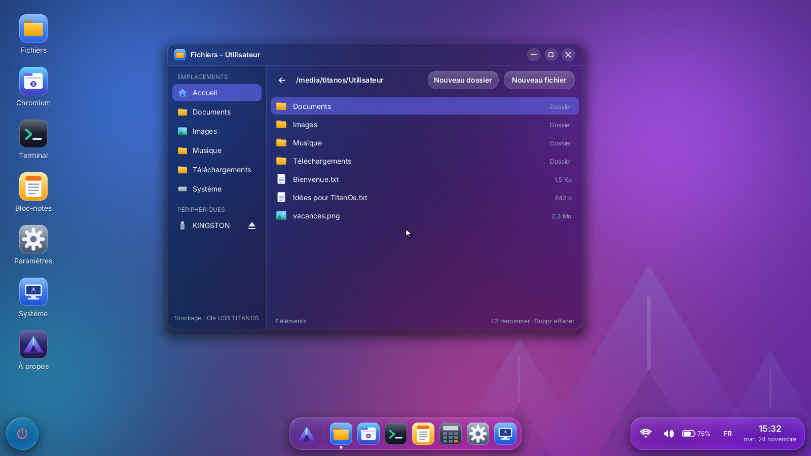
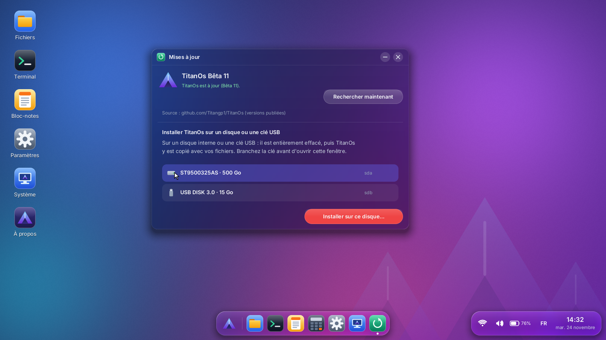
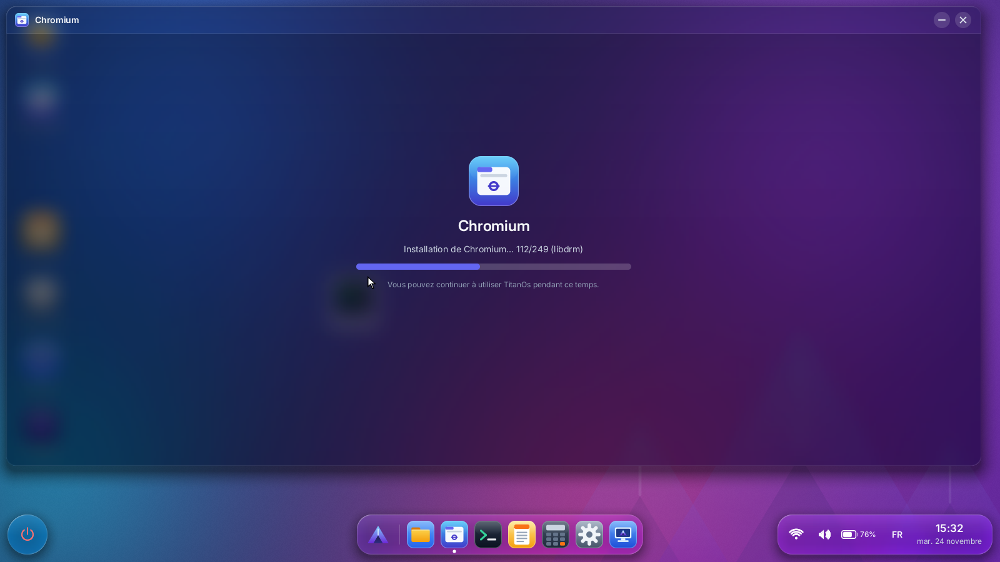

<div align="center">

# TitanOs

<p>
<a href="https://titangp1.github.io/TitanOs/"></a>
<a href="https://github.com/Titangp1/TitanOs/releases/latest"></a>


</p>

**Un système d'exploitation léger, sur base Debian, avec un bureau *liquid glass* écrit en C.**
Pensé pour le Sony VAIO série F, il démarre sur n'importe quel PC 64 bits (BIOS ou UEFI).

[**Télécharger la dernière version**](../../releases/latest) · [Le site](https://titangp1.github.io/TitanOs/) · [Historique des versions](CHANGELOG.md) · [Versionnage](#versions) · [Contribuer](CONTRIBUTING.md)



</div>

---

## En bref

Ce que vous voyez est écrit pour TitanOs :
- les chargeurs de démarrage BIOS et UEFI, et l'écran de démarrage ;
- `/init`, le chargement des pilotes ;
- le bureau, avec ses animations, ses sons et ses applications.

Le bureau est un seul programme en C, sans bibliothèque (ni libc, ni X11, ni Wayland) : il parle directement au noyau.

En dessous, deux bases éprouvées :
- le **noyau Linux** : le paquet `linux-lts` d'Alpine Linux, pris tel quel ;
- **Debian 13** (trixie), réduite à l'essentiel (environ 330 paquets) :
  - systemd démarre les services ;
  - NetworkManager gère le Wi-Fi et le câble ;
  - PipeWire gère le son ;
  - `apt` installe n'importe quel programme Linux : les applications « normales » (Google Chrome, Discord, VS Code…) s'installent avec leur paquet officiel.

Debian s'installe tout seul au premier démarrage, depuis la clé, avec une barre de progression. Sans lui (clé trop petite, échec), TitanOs démarre comme avant sur son système autonome (BusyBox, `wpa_supplicant`, `apk`).

## Points forts

| | |
|---|---|
| **Démarrage sans coupure** | Le logo et les *crêtes* animées s'affichent dès l'allumage. Linux reprend la même image, puis l'écran passe en fondu sur l'écran de verrouillage. |
| **Liquid glass** | Chaque panneau floute et réfracte ce qui est derrière lui, avec un liseré lumineux et un reflet. Le verre n'est recalculé que là où c'est utile. |
| **Fluide à 60 Hz** | Le bureau dessine dans une image en mémoire vidéo pendant que l'autre est affichée, et la carte graphique bascule au rafraîchissement de l'écran : pas de déchirure. |
| **Animations** | Les fenêtres s'ouvrent avec un léger zoom, se réduisent vers leur icône du dock et en reviennent. L'agrandissement est animé ; les menus et les notifications apparaissent en fondu. |
| **Mises à jour automatiques** | Une fois en ligne, TitanOs cherche une version plus récente ici, la télécharge en HTTPS, vérifie ses sommes SHA-256 et l'installe. Il suffit ensuite de redémarrer. |
| **Installation** | Comme pour Windows : la clé d'installation ouvre un assistant qui installe TitanOs sur le disque de l'ordinateur. La clé ne sert qu'à l'installation. |
| **Intégration au portable** | Batterie, touches Fn (luminosité, volume), couvercle, bouton d'alimentation, mise en veille, températures, interrupteur Wi-Fi du VAIO. |
| **Navigateur web** | Google Chrome (le paquet officiel de Google), installé quand vous le décidez : `installer-chrome` dans le Terminal. Il s'ouvre dans une fenêtre TitanOs ; les téléchargements vont dans *Téléchargements* ; le son passe par PipeWire et le haut-parleur. |
| **Logithèque** | LibreOffice, VS Code, Discord, GIMP, Python et Node.js s'installent en un clic, et la recherche trouve tout paquet Debian. Chaque application graphique a sa propre fenêtre et rejoint le menu Démarrer avec son icône. |
| **Applications Linux** | `apt install htop` dans le Terminal installe un programme de Debian (sudo est demandé tout seul). Il reste installé dans l'espace des applications. |
| **Sécurité** | Le Terminal tourne sous le compte `titan`, sans droits d'administrateur. `sudo` demande le mot de passe de session ; sans mot de passe défini, il refuse. |
| **Pointeur** | Flèche noire bordée de blanc avec une ombre douce, affichée par la carte graphique : elle suit la souris sans attendre l'image suivante. Elle change de forme sur le texte, les coins de redimensionnement, les liens des pages web. |

<table>
<tr>
<td></td>
<td></td>
</tr>
<tr>
<td></td>
<td></td>
</tr>
<tr>
<td></td>
<td></td>
</tr>
<tr>
<td></td>
<td></td>
</tr>
</table>

## Nouveautés récentes

| | |
|---|---|
| **Accueil du premier démarrage** | Comme sous Windows : clavier, fuseau horaire, Wi-Fi, nom, mot de passe, fond d'écran et couleur, en quelques écrans. |
| **Clé d'installation** | La clé ne contient plus le système : elle installe TitanOs sur le disque de l'ordinateur, avec un assistant (disque, confirmation, progression). Rien ne se télécharge tout seul : les applications s'installent dans le Terminal. |
| **Base Debian** | Debian 13 sous le bureau de TitanOs : apt, NetworkManager, PipeWire, systemd. Chrome, Discord et VS Code s'installent avec leur paquet officiel. Installée toute seule au premier démarrage. |
| **Fenêtres** | Ancrage sur les moitiés de l'écran avec aperçu, vue d'ensemble animée de toutes les fenêtres. |
| **Éclairage nocturne** | Couleurs plus chaudes le soir (Paramètres → Écran), appliquées par la carte graphique, sans coût pour le processeur. |
| **Recherche** | Le menu Démarrer trouve les applications et les fichiers de l'utilisateur. |
| **Paquets** | La Logithèque cherche et installe n'importe quel paquet Debian. Dans le Terminal, `apt install` demande sudo tout seul. |
| **Réseau** | Console réseau en direct, connexion suivie jusqu'au résultat, Wi-Fi WPA3 et Entreprise. |

Tout le détail est dans l'[historique des versions](CHANGELOG.md).

## Installer

TitanOs s'installe comme Windows : une **clé d'installation** démarre un assistant qui installe le système sur le disque de l'ordinateur. Le système ne tourne pas depuis la clé.

1. Téléchargez `titanos-installeur-betaN.img.zip` dans la [dernière version](../../releases/latest), puis décompressez-le.
2. Écrivez `titanos.img` sur une clé USB d'au moins 1 Go avec **Rufus, en mode DD** (cela efface la clé).
3. Démarrez l'ordinateur sur la clé :
   - **Sony VAIO (BIOS)** : touche F2, onglet *Boot*, activez *External Device Boot* et mettez la clé en premier ;
   - **PC récent (UEFI)** : désactivez *Secure Boot*.
4. L'assistant d'installation s'ouvre. Choisissez le disque (16 Go au moins), confirmez, puis attendez la fin de la copie. **Le disque choisi est entièrement effacé**, Windows compris.
5. Retirez la clé et redémarrez. Au premier démarrage, TitanOs installe sa base Debian, avec une barre de progression : quelques minutes, une seule fois.
6. L'**accueil** s'ouvre ensuite, comme sous Windows :
   - clavier (AZERTY ou QWERTY) et fuseau horaire ;
   - connexion Wi-Fi ;
   - votre nom et votre mot de passe ;
   - fond d'écran et couleur d'accent.

   Puis le bureau apparaît.

Le disque est partagé en deux :
- **TitanOs et vos fichiers** (FAT32) : la plus grande partie ;
- **l'espace des applications** (Debian, ext4) : un tiers du disque, entre 8 et 64 Go.

Il faut 1 Go de mémoire au minimum. Une fois TitanOs installé, les nouvelles versions arrivent toutes seules.

**Applications** : rien ne s'installe tout seul. Dans le Terminal, `apt install nom` installe un programme de Debian. Pour les applications de leurs éditeurs, tapez `installer-chrome`, `installer-discord` ou `installer-vscode`. La Logithèque reste disponible pour le faire à la souris.

**Mettre à jour sans Internet** : démarrez sur une clé d'installation plus récente, puis choisissez « Mettre à jour le TitanOs déjà installé » (vos fichiers sont gardés). Autre solution : copiez `titanos-maj.tar.gz` (dans chaque version publiée) sur une clé USB, branchez-la, puis cliquez sur « Installer ce paquet » dans Mises à jour.

## Applications

| Application | Rôle |
|---|---|
| **Google Chrome** | Le navigateur de Google, paquet officiel (mis à jour avec Debian), installé par `installer-chrome` dans le Terminal ou par le bouton de sa fenêtre : onglets, compte Google, favoris, téléchargements, vidéos avec le son. Il tourne sous le compte `titan`, avec son bac à sable et la disposition de clavier de TitanOs. |
| **Logithèque** | Installe et désinstalle LibreOffice, GIMP, Python 3 et Node.js (Debian), VS Code et Discord (paquets officiels). La recherche trouve tout paquet Debian. Les installations se font une à la fois, avec une barre de progression. |
| **Fichiers** | Dossiers et fichiers : créer, renommer (F2), dupliquer, supprimer avec confirmation. Chaque fichier s'ouvre avec la bonne application : textes dans le Bloc-notes, images dans la visionneuse, PDF, vidéos, musique et pages web dans Google Chrome. Les archives (zip, tar.gz, tar.xz…) s'extraient d'un double-clic. Les clés USB branchées apparaissent, avec un bouton *Éjecter*. |
| **Terminal** | Vrai terminal (VT100/xterm, 256 couleurs) avec bash, sous le compte `titan`. `sudo` pour l'administration (mot de passe de session). Les commandes de Debian : apt, nmcli, journalctl, systemctl, lsblk, lspci, lsusb, nano, less, htop, tree, zip, iw… `aide` les présente. |
| **Bloc-notes** | Édition UTF-8, sélection, copier/coller, Ctrl+S / Ctrl+O. Avertit avant de fermer un texte non enregistré. |
| **Image** | Visionneuse JPEG (séquentiel et progressif, orientation EXIF), PNG, GIF, BMP et PPM, ajustée à la fenêtre ; ← → pour l'image suivante. |
| **Calculatrice** | À la souris ou au clavier. |
| **Paramètres** | Personnalisation, écran, son, clavier et souris, réseau, date et heure, compte (mot de passe de session), système. |
| **Système** | Machine, températures, batterie, matériel PCI/USB avec son pilote, processus. |
| **Réseau** | Wi-Fi WPA2, WPA3, WPA2-Entreprise (identifiant et mot de passe), réseaux ouverts et masqués, mot de passe affichable, réseaux enregistrés ; câble, partage USB d'un téléphone. Le test de connexion vérifie chaque étape (adresse, box, Internet, DNS) et dit laquelle bloque. Le Wi-Fi passe par NetworkManager. La **console réseau** montre en direct ce que font la carte et NetworkManager, erreurs expliquées en français, et s'enregistre dans un fichier. |
| **Mises à jour** | Version installée, recherche sur GitHub ; « Rechercher » met aussi à jour les programmes Debian. |
| **Snake**, **À propos** | |

**Raccourcis**

| Raccourci | Action |
|---|---|
| Touche Windows | Menu et recherche |
| Alt+Tab | Passer d'une fenêtre à l'autre |
| Alt+F4 | Fermer la fenêtre |
| Ctrl+Alt+T | Ouvrir le Terminal |
| Windows+L | Verrouiller la session |
| Impr. écran | Capture d'écran, enregistrée dans *Images* |
| F3, ou souris dans le coin en haut à gauche | Vue d'ensemble : toutes les fenêtres côte à côte |
| Fenêtre lâchée contre un bord | Moitié gauche ou droite de l'écran ; contre le haut : plein écran |
| Ctrl+C, Ctrl+X, Ctrl+V (Fichiers) | Copier, couper, coller des fichiers et des dossiers |

Le bouton rond en bas à gauche propose : mettre en veille, redémarrer ou éteindre.

**Bureau** : les icônes se déplacent à la souris. Elles se rangent dans une grille qui couvre tout l'écran, et gardent leur place. Pour ajouter un raccourci, faites un clic droit sur le bureau, sur une application du menu Démarrer, ou sur un fichier ou un dossier dans Fichiers. Pour le retirer : clic droit sur l'icône → « Retirer du bureau ».

## Matériel

TitanOs est réglé pour le **Sony VAIO série F (VPCF11)**.

| Composant | Prise en charge |
|---|---|
| Écran | Carte NVIDIA GeForce GT 330M (puce GT216) avec le pilote libre `nouveau` : 1920×1080 à 60 Hz, double tampon. Chaque image est envoyée à la carte au rafraîchissement de l'écran, puis la suivante est préparée aussitôt. Les mélanges sont calculés 4 pixels à la fois (SSE2), et la copie vers la mémoire vidéo contourne le cache. Au démarrage, le chargeur prend la résolution de l'écran, même si la carte ne la propose qu'en 16 ou 24 bits (image tramée). Sinon, il utilise des images dessinées pour le mode 1280×1024 du BIOS, aux bonnes proportions. Le pointeur est affiché par la carte (plan « curseur »). |
| Wi-Fi | Intel Centrino Advanced-N 6200 (`iwlwifi`, micrologiciel officiel d'Intel, sans coexistence Bluetooth ni économie d'énergie) ou Atheros AR9287 (`ath9k`). L'interrupteur WIRELESS est détecté et expliqué. |
| Câble | Marvell Yukon (`sky2`) : le branchement est surveillé, l'adresse est demandée tout de suite. Câble, partage USB d'un téléphone et Wi-Fi ont chacun leur priorité : Internet passe par le meilleur lien branché. |
| Son | HD Audio (Realtek ALC275), volume réglable aux touches Fn. Les applications passent par PulseAudio (Chrome, Discord) ou ALSA, réglée sur cette sortie avec un mélangeur logiciel. |

Sur les autres PC, les pilotes Intel (`i915`), QEMU et VirtIO sont inclus. Sans pilote adapté, l'écran reste à la résolution donnée par le BIOS.

## Si quelque chose ne va pas

- **Journal** : TitanOs écrit `journal-titanos.txt` à la racine de la clé, toutes les 5 secondes pendant les 4 premières minutes, puis toutes les 5 minutes. Il y note les messages du noyau, les pilotes, le Wi-Fi, et où chaque processus attend.
- **Mode de secours** : si le bureau plante plusieurs fois de suite, TitanOs affiche la cause à l'écran et copie `rapport-titanos.txt` sur la clé.
- **Ligne de diagnostic** : en bas de l'écran de verrouillage, elle apparaît si la clé, le clavier ou le pointeur manquent.
- **Installation de Debian** : son déroulé complet est copié dans `installation-debian.txt`. Si elle échoue, TitanOs s'ouvre sans Debian et réessaie au démarrage suivant (deux fois au plus).
- **Bureau absent dans Debian** : s'il ne démarre pas, TitanOs copie `journal-debian.txt` sur la clé et redémarre sans Debian, jusqu'à la version suivante.

Branchez la clé sur un autre ordinateur pour lire ces fichiers.

## Limites actuelles

- Les applications graphiques Linux (Google Chrome, LibreOffice, VS Code, Discord, GIMP) tournent chacune dans un serveur X en mémoire (Xvfb), dessiné par le processeur : la navigation est fluide, les vidéos lourdes le sont moins.
- Le câble Ethernet du VAIO (Marvell Yukon, pilote `sky2`) ne détecte toujours pas le branchement.
- Vos fichiers sont sur une partition FAT32 : un fichier ne peut pas dépasser 4 Go.
- Le dessin se fait au processeur : la carte graphique sert à l'affichage et à la synchronisation, pas à la 3D.
- Les mises à jour sont vérifiées par HTTPS et SHA-256, pas encore par une signature.

## Compiler

Prérequis : [LLVM](https://llvm.org) (`clang`, `ld.lld`, `lld-link`) et Python 3.14 ou plus récent (le build utilise `compression.zstd`).

```powershell
winget install LLVM.LLVM
```

```powershell
python build.py
```

Au premier lancement, le build télécharge environ 400 Mo et les garde dans `build/cache/` :
- depuis le miroir officiel d'Alpine : noyau, BusyBox, paquets et police Inter, tous vérifiés par leurs sommes de contrôle ;
- depuis le miroir officiel de linux-firmware : le micrologiciel Wi-Fi Intel, vérifié par son SHA-256 ;
- depuis `deb.debian.org` : les paquets de la base Debian, choisis avec leurs dépendances par `tools/debian.py` et vérifiés par leur SHA-256.

| Résultat | Rôle |
|---|---|
| `build/titanos.img` | Clé d'installation d'environ 700 Mo (BIOS et UEFI), base Debian comprise |
| `build/titanos.vhd` | La même image, en disque virtuel |
| `build/titanos-maj.tar.gz` et `build/VERSION` | Paquet de mise à jour, à publier avec chaque version |
| `build/gen/DEBIAN.TXZ` et `build/gen/DEBS.TAR` | La base Debian (système de départ, puis paquets), aussi publiée pour les mises à jour |

```powershell
python build.py preview
```

Cette commande compile le bureau pour Windows et enregistre des captures dans `build/preview/`.

```powershell
python tools/testboot.py build/titanos.img build/preview/chargeur.png
```

Ce test exécute le MBR et le chargeur BIOS dans un émulateur de processeur, jusqu'à l'entrée du noyau Linux. Il demande `pip install unicorn`. `TESTBOOT_VAIO=2` et `TESTBOOT_NOEDID=1` imitent le BIOS du VAIO.

## Comment c'est construit

```
                 ┌─ BIOS ─► MBR (boot/mbr.S) ─► stage2 (boot/stage2.S) ─┐
PC allumé ──────►│                                                       ├─► noyau Linux ─► /init (TitanOs)
                 └─ UEFI ─► BOOTX64.EFI (boot/efiboot.c) ────────────────┘
```

- **stage2** choisit le mode graphique d'après l'écran (EDID) et dessine l'écran de démarrage depuis `TITANOS/BOOT.IMG`. Il lit ensuite le noyau et le système en mode « unreal », remplit la carte mémoire et entre dans Linux par son protocole 32 bits. Il transmet aussi la signature du disque qui a démarré.
- **efiboot** dessine le même écran, puis passe le système au noyau par le protocole LoadFile2.
- **`/init`** (PID 1) monte `/proc`, `/sys` et `/dev`, active la mémoire compressée (zram) et charge les pilotes. Il relance le bureau s'il s'arrête, et ouvre le mode de secours s'il plante en boucle.
- **Base Debian** : la partition ext4 de la clé contient un Debian complet (`/.titan/debian`). Au premier démarrage, il est extrait de `TITANOS/DEBIAN.TXZ`, puis `debian/setup.sh` installe les paquets de `DEBS.TAR`, comme le ferait debootstrap. Dès qu'il est prêt, `/init` y bascule (`switch_root`) : systemd démarre, puis relance le même programme TitanOs (`titanos --session`) pour le bureau.
- **La session** anime l'écran de démarrage pendant qu'un processus voisin charge les pilotes, monte la clé et prépare l'espace des applications. Un autre processus, le **veilleur**, interroge le Wi-Fi et la batterie : le bureau n'attend jamais le matériel.
- **Mises à jour** : les fichiers du système ont une taille fixe sur le disque. Les nouvelles versions les réécrivent sur place, puis réécrivent le chargeur.

## Organisation du code

```
build.py              compile tout ; « preview » pour les captures
boot/                 MBR, chargeur BIOS (stage2.S), chargeur UEFI (efiboot.c)
src/core/             le bureau, indépendant du système
  gfx.c glass.c icons.c           dessin lissé, verre, logo et icônes
  png.c jpeg.c                     images PNG, BMP, JPEG, GIF, PPM
  wm.c ui.c sound.c                fenêtres, dock, animations, widgets, sons
  apps.c term.c files.c notes.c prefs.c sysapp.c netapp.c updapp.c imgview.c browser.c store.c   applications
src/linux/            ce qui parle au noyau (appels système directs, sans libc)
  main.c                           /init, démarrage, clé, zram, espace des applications
  modules.c display.c input.c      pilotes, écran DRM/KMS (double tampon), clavier, souris, pavé tactile
  audio.c wifi.c nm.c plat.c       son ALSA, Wi-Fi (NetworkManager, ou wpa_supplicant sans Debian), fichiers, système, batterie
  update.c volumes.c xbridge.c     mises à jour et installation, clés USB, applications X11 (un serveur X par application)
src/sim/sim.c         version Windows du bureau, pour l'aperçu
docs/                 le site (GitHub Pages) : index.html, assets/ ; captures du README
rootfs/etc/           système autonome : profil du shell, script DHCP, dépôts apk
debian/               base Debian : seconde étape (setup.sh) et réglages (/etc)
tools/                téléchargement Alpine et Debian (debian.py), polices, initramfs, image disque, écran de démarrage, tests
```

## Personnaliser

| Pour… | Modifier |
|---|---|
| ajouter une application | une fonction `app_xxx_open()` (voir `src/core/apps.c`), son icône dans `icons.c`, son nom dans `apps.c` et `desk.h` |
| changer l'effet verre | `style_for()` dans `src/core/wm.c`, et `src/core/glass.c` |
| fonds d'écran, couleurs, fuseaux | `src/core/settings.c` |
| les sons | `src/core/sound.c` (chaque son est une petite partition de notes) |
| ajouter un programme à la base Debian | `BASE` dans `tools/debian.py` |
| les réglages de Debian (services, réseau, Terminal) | `debian/setup.sh` et `debian/etc/` |
| ajouter un pilote au démarrage | `MODULES` dans `tools/buildos.py` |

## Versions

TitanOs suit un **numéro de version sémantique** `majeur.mineur.correctif`, complété du numéro de bêta :

| Version | Tag Git | Nom affiché | Statut |
|---|---|---|---|
| **0.35.0** | `v0.35.0-beta.35` | TitanOs Bêta 35 | dernière version : accueil du premier démarrage |
| 0.34.0 | `v0.34.0-beta.34` | TitanOs Bêta 34 | clé d'installation |
| 0.33.0 | `v0.33.0-beta.33` | TitanOs Bêta 33 | base Debian |
| 0.32.0 | `v0.32.0-beta.32` | TitanOs Bêta 32 | |

- **majeur** (`0`) : reste à 0 tant que TitanOs est en bêta. La version 1.0.0 sera la première version stable.
- **mineur** : augmente à chaque bêta publiée (bêta 32 → `0.32.0`).
- **correctif** : pour une correction publiée sans nouvelle fonction (`0.32.1`...).

Chaque version publiée contient :
- `titanos-installeur-beta35.img.zip`, la clé d'installation à écrire avec Rufus, balenaEtcher ou `dd` ;
- `titanos-maj.tar.gz`, la mise à jour par Internet ou par clé USB ;
- `VERSION`, le numéro de bêta, lu par la recherche automatique des mises à jour ;
- `DEBIAN.TXZ` et `DEBS.TAR`, la base Debian, téléchargée par les TitanOs installés avant la bêta 33.

TitanOs installé se met à jour tout seul à partir de la dernière version publiée. L'historique complet est dans [CHANGELOG.md](CHANGELOG.md).

## Licence

TitanOs est © 2026 **Titangp1**. Il est distribué sous la licence libre **GNU GPL version 3 ou ultérieure** : voir [LICENSE](LICENSE) et [NOTICE](NOTICE).

- Le projet et son code restent la propriété de leur auteur, et chaque copie doit le créditer.
- Tout le monde peut lire le code, l'utiliser et proposer des améliorations ([CONTRIBUTING.md](CONTRIBUTING.md)).
- Une version modifiée doit rester libre, sous la même licence, avec son code source. Personne ne peut en faire un logiciel fermé.
- Le nom TitanOs et son logo désignent la version officielle.

## Licences des composants embarqués

| Composant | Licence |
|---|---|
| Noyau Linux, BusyBox | GPL |
| Debian (paquets de la base) | Licences libres de chaque paquet (voir `/usr/share/doc/*/copyright`) ; micrologiciels de `non-free-firmware` sous leur licence de redistribution |
| `wpa_supplicant` | BSD |
| `curl` | Licence curl (MIT) |
| Police Inter | SIL OFL 1.1 |
| Micrologiciel Intel | Licence de redistribution d'Intel (linux-firmware) |
